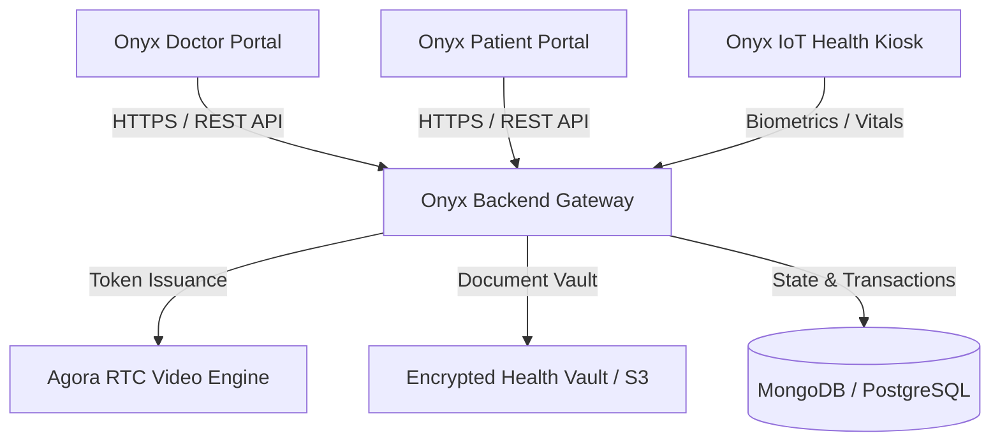
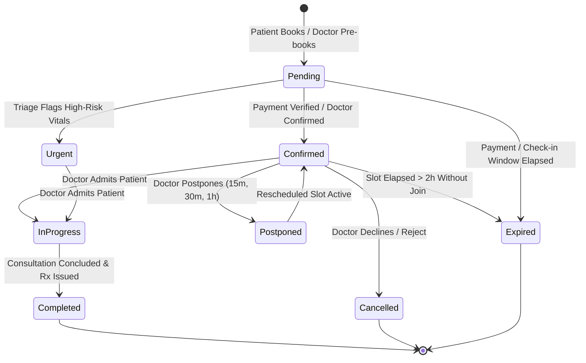

# ONYX HEALTH+ DOCTOR SYSTEM: BACKEND HANDOVER SPECIFICATION
## Comprehensive API Contracts, Data Schemas, Status Lifecycles & Telehealth Architecture

**Document Version:** 2.0.0  
**Target Systems:** Node.js / Express / NestJS / MongoDB / PostgreSQL Backend Services  
**Consumer Applications:** 
- Onyx Doctor Portal (`onyx-health-flow`)
- Onyx Patient Portal (`onyx-patient-flow`)
- Onyx Kiosk Screening Station  

---

## 1. EXECUTIVE SUMMARY & ARCHITECTURE OVERVIEW

The **Onyx Health+ Doctor System** is a unified clinical telemedicine workspace enabling licensed physicians to manage schedules, conduct high-definition Agora RTC video consultations, review patient health reports, and issue digital prescriptions.



### Key Functional Requirements Addressed in this Handover
1. **Doctor Availability & Shift Hours:** API to persist and retrieve doctor weekly working shifts, slot intervals, and buffer durations.
2. **Direct Doctor Slot Booking:** Allow doctors to directly schedule appointments for patients from the calendar.
3. **Standardized Appointment Statuses:** Strict 5-state lifecycle (`Confirmed`, `Urgent`, `Pending`, `Completed`, `Expired`).
4. **Consultation Lifecycle Workflow:** Dedicated endpoints for **Admit**, **Reject**, and **Postpone** consultations with real-time patient notifications.
5. **Patient Health Reports:** Ingestion and retrieval of diagnostic reports uploaded by patients during booking and real-time viewing during video calls.
6. **Agora RTC Encrypted Telehealth:** Production-ready token generation with integer UIDs for dual-portal audio/video calls.

---

## 2. APPOINTMENT STATUS LIFECYCLE & STATE MACHINE

All appointments throughout the Onyx ecosystem adhere to the following 5 canonical statuses:



### Status Definitions

| Status | Meaning & Clinical Context | Frontend Badge Styling |
| :--- | :--- | :--- |
| `Confirmed` | Verified appointment with reserved slot. Patient expected in waiting room. | Blue (`#2563EB`) |
| `Urgent` | Priority triage / abnormal IoT kiosk telemetry. Requires immediate doctor attention. | Rose / Crimson (`#F2052C`) |
| `Pending` | Pre-booked slot awaiting patient check-in or clinical verification. | Amber (`#F59E0B`) |
| `Completed` | Consultation concluded, clinical notes signed, and digital prescription issued. | Vital Emerald (`#10B981`) |
| `Expired` | Scheduled slot window has passed without attendance. Archived from active queue. | Slate Grey (`#94A3B8`) |

---

## 3. DOCTOR AVAILABILITY & WORKING HOURS API

Doctors configure their recurring consultation availability, slot durations (15m, 20m, 30m, 45m), and buffer times. The backend must persist these records and use them to generate patient-facing booking slots.

### 3.1 Get Doctor Availability
- **Method:** `GET`
- **Route:** `/api/doctor/availability` (or `/api/doctor/availability?doctorId={doctorId}`)
- **Auth:** Bearer JWT (Doctor)

#### Response (`200 OK`)
```json
{
  "success": true,
  "doctorId": "doc_6711a9f029",
  "isAvailable": true,
  "slotDuration": 30,
  "bufferDuration": 5,
  "weeklySchedule": [
    {
      "dayName": "Sunday",
      "dayIndex": 0,
      "enabled": false,
      "shifts": [{ "start": "10:00", "end": "14:00" }]
    },
    {
      "dayName": "Monday",
      "dayIndex": 1,
      "enabled": true,
      "shifts": [
        { "start": "09:00", "end": "13:00" },
        { "start": "14:00", "end": "18:00" }
      ]
    },
    {
      "dayName": "Tuesday",
      "dayIndex": 2,
      "enabled": true,
      "shifts": [
        { "start": "09:00", "end": "13:00" },
        { "start": "14:00", "end": "18:00" }
      ]
    },
    {
      "dayName": "Wednesday",
      "dayIndex": 3,
      "enabled": true,
      "shifts": [
        { "start": "09:00", "end": "13:00" },
        { "start": "14:00", "end": "18:00" }
      ]
    },
    {
      "dayName": "Thursday",
      "dayIndex": 4,
      "enabled": true,
      "shifts": [
        { "start": "09:00", "end": "13:00" },
        { "start": "14:00", "end": "18:00" }
      ]
    },
    {
      "dayName": "Friday",
      "dayIndex": 5,
      "enabled": true,
      "shifts": [
        { "start": "09:00", "end": "13:00" },
        { "start": "14:00", "end": "18:00" }
      ]
    },
    {
      "dayName": "Saturday",
      "dayIndex": 6,
      "enabled": true,
      "shifts": [{ "start": "10:00", "end": "14:00" }]
    }
  ]
}
```

### 3.2 Update Doctor Availability
- **Method:** `POST`
- **Route:** `/api/doctor/availability`
- **Auth:** Bearer JWT (Doctor)

#### Request Payload
```json
{
  "isAvailable": true,
  "slotDuration": 30,
  "bufferDuration": 5,
  "weeklySchedule": [
    {
      "dayName": "Monday",
      "dayIndex": 1,
      "enabled": true,
      "shifts": [
        { "start": "09:00", "end": "13:00" },
        { "start": "14:00", "end": "18:00" }
      ]
    }
  ]
}
```

#### Response (`200 OK`)
```json
{
  "success": true,
  "message": "Doctor availability and shift intervals synchronized successfully.",
  "updatedAt": "2026-10-26T16:00:00.000Z"
}
```

---

## 4. DIRECT DOCTOR BOOKING API

Doctors have the clinical authority to directly schedule appointment slots for walk-in patients or scheduled follow-ups.

- **Method:** `POST`
- **Route:** `/api/booking/doctor-create` (or `/api/booking/create`)
- **Auth:** Bearer JWT (Doctor)

#### Request Payload
```json
{
  "doctorId": "doc_6711a9f029",
  "patientName": "Ramesh Verma",
  "patientPhone": "+91 98765 43210",
  "slotDate": "2026-10-26",
  "slotTimeStart": "10:30",
  "slotTimeEnd": "11:00",
  "duration": 30,
  "type": "Consultation",
  "status": "Confirmed",
  "reason": "Cardiovascular routine follow-up"
}
```

#### Response (`201 Created`)
```json
{
  "success": true,
  "booking": {
    "_id": "bk_88921a44",
    "doctorId": "doc_6711a9f029",
    "patientName": "Ramesh Verma",
    "slotDate": "2026-10-26T00:00:00.000Z",
    "slotTimeStart": "10:30",
    "slotTimeEnd": "11:00",
    "duration": 30,
    "status": "Confirmed",
    "type": "Consultation",
    "createdAt": "2026-10-26T16:05:00.000Z"
  }
}
```

---

## 5. CONSULTATION ACTIONS: ADMIT, REJECT, POSTPONE

Doctors need granular controls over the consultation queue: admitting patients into the video suite, postponing slots with patient notices, or rejecting unsuitable bookings.

### 5.1 Unified Status Change Endpoint
- **Method:** `POST`
- **Route:** `/api/booking/status`
- **Auth:** Bearer JWT (Doctor)

#### 5.1.1 Admit Patient
```json
{
  "bookingId": "bk_88921a44",
  "status": "In Progress",
  "action": "admit"
}
```
*Backend action:* Transitions booking status to `In Progress`. Emits WebSocket/Push event `patient-admitted` to the patient portal so the patient's video interface connects automatically.

#### 5.1.2 Postpone Appointment
```json
{
  "bookingId": "bk_88921a44",
  "status": "Postponed",
  "postponeMinutes": 15,
  "reason": "Doctor attending emergency triage. Session will commence shortly."
}
```
*Backend action:* Adds `postponeMinutes` to `slotTimeStart` (e.g. 10:30 -> 10:45). Updates `status` to `Postponed`. Sends SMS/WebSocket push notification to the patient.

#### 5.1.3 Reject / Decline Appointment
```json
{
  "bookingId": "bk_88921a44",
  "status": "Cancelled",
  "action": "reject",
  "reason": "Specialty mismatch / Out of clinical scope",
  "notes": "Patient advised to consult in-person cardiologist for ECG evaluation."
}
```
*Backend action:* Sets status to `Cancelled`. Logs rejection rationale. Initiates automated refund if paid or credits free consultation coupon. Notifies patient.

---

## 6. PATIENT HEALTH REPORTS IN APPOINTMENT DETAILS & IN-CALL VIEWER

When a patient books an appointment, any diagnostic reports uploaded or selected from their profile must be attached to the booking. During both intake and the live video consultation, the doctor must be able to view these files.

### 6.1 Get Booking Reports
- **Method:** `GET`
- **Route:** `/api/booking/:bookingId/reports`
- **Auth:** Bearer JWT (Doctor / Patient)

#### Response (`200 OK`)
```json
{
  "success": true,
  "bookingId": "bk_88921a44",
  "reports": [
    {
      "_id": "rep_cbc_001",
      "title": "Comprehensive Metabolic & CBC Blood Panel",
      "type": "Lab Report",
      "date": "2026-10-24",
      "fileUrl": "https://vault.onyxhealth.com/reports/cbc_panel_88921.pdf",
      "fileSize": "1.4 MB",
      "summary": "Hemoglobin 14.2 g/dL, WBC 6,800 /mcL, Fasting Blood Sugar 98 mg/dL. All metabolic parameters normal.",
      "isVerified": true,
      "uploadedBy": "patient"
    },
    {
      "_id": "rep_rad_002",
      "title": "Digital Chest Radiograph (PA View)",
      "type": "Radiology",
      "date": "2026-10-22",
      "fileUrl": "https://vault.onyxhealth.com/reports/chest_xray_88921.dcm",
      "fileSize": "4.8 MB",
      "summary": "Clear lung fields bilaterally without focal consolidation. Normal cardiothoracic ratio.",
      "isVerified": true,
      "uploadedBy": "patient"
    }
  ]
}
```

### 6.2 Attach Report to Booking
- **Method:** `POST`
- **Route:** `/api/booking/:bookingId/attach-report`
- **Auth:** Bearer JWT (Patient / Doctor)

#### Request Payload
```json
{
  "reportId": "rep_cbc_001"
}
```

---

## 7. AGORA RTC ENCRYPTED VIDEO SUITE API

High-definition, end-to-end encrypted video consultations require an Agora RTC token generated per booking room.

- **Method:** `GET`
- **Route:** `/api/video/token/:bookingId`
- **Auth:** Bearer JWT (Doctor / Patient)

#### Response (`200 OK`)
```json
{
  "token": "0062a488e1...[Agora RTC Dynamic Token]...",
  "channelName": "room-bk_88921a44",
  "appId": "2a488e1b6f004928b991b17b2829103c",
  "uid": 249102,
  "role": "publisher",
  "expiresIn": 86400
}
```

> **Backend Developer Note:** Always assign doctors numeric UIDs in the range `200000 - 999999` and patients numeric UIDs in the range `100000 - 199999`. This ensures clean stream attribution across both web clients.

---

## 8. DIGITAL PRESCRIPTIONS & POST-CALL SIGNING

When a doctor concludes a video consultation, the clinical diagnosis and prescribed medications are signed and stored.

- **Method:** `POST`
- **Route:** `/api/prescriptions`
- **Auth:** Bearer JWT (Doctor)

#### Request Payload
```json
{
  "bookingId": "bk_88921a44",
  "patientName": "Ramesh Verma",
  "diagnosis": "Hypertension Maintenance & Routine Follow-up",
  "duration": "30 days",
  "instructions": "Take with warm water after breakfast.",
  "medications": [
    {
      "name": "Amlodipine 5mg",
      "dosage": "5mg",
      "frequency": "Once daily (OD)",
      "duration": "30 days",
      "instructions": "Morning after food"
    },
    {
      "name": "Telmisartan 40mg",
      "dosage": "40mg",
      "frequency": "Once daily (OD)",
      "duration": "30 days",
      "instructions": "Morning with water"
    }
  ],
  "doctorNotes": "BP recorded at 128/82. Follow-up in 4 weeks."
}
```

#### Response (`201 Created`)
```json
{
  "success": true,
  "prescriptionId": "rx_990141",
  "pdfUrl": "https://vault.onyxhealth.com/prescriptions/rx_990141.pdf",
  "issuedDate": "2026-10-26T16:15:00.000Z"
}
```

---

## 9. RECOMMENDED DATABASE SCHEMAS (MONGODB / MONGOOSE)

### 9.1 `DoctorAvailability` Schema
```typescript
const ShiftIntervalSchema = new mongoose.Schema({
  start: { type: String, required: true }, // "09:00"
  end: { type: String, required: true },   // "13:00"
});

const DayAvailabilitySchema = new mongoose.Schema({
  dayName: { type: String, required: true },
  dayIndex: { type: Number, required: true, min: 0, max: 6 },
  enabled: { type: Boolean, default: true },
  shifts: [ShiftIntervalSchema],
});

const DoctorAvailabilitySchema = new mongoose.Schema({
  doctorId: { type: mongoose.Schema.Types.ObjectId, ref: "Doctor", required: true, unique: true },
  isAvailable: { type: Boolean, default: true },
  slotDuration: { type: Number, default: 30 }, // Minutes
  bufferDuration: { type: Number, default: 5 }, // Minutes
  weeklySchedule: [DayAvailabilitySchema],
}, { timestamps: true });
```

### 9.2 `Booking` Schema Additions
```typescript
const BookingSchema = new mongoose.Schema({
  doctorId: { type: mongoose.Schema.Types.ObjectId, ref: "Doctor", required: true },
  userId: { type: mongoose.Schema.Types.ObjectId, ref: "User" },
  profileId: { type: mongoose.Schema.Types.ObjectId, ref: "Profile" },
  patientName: { type: String, required: true },
  slotDate: { type: Date, required: true },
  slotTimeStart: { type: String, required: true }, // "10:30"
  slotTimeEnd: { type: String },                   // "11:00"
  duration: { type: Number, default: 30 },
  status: {
    type: String,
    enum: ["Confirmed", "Urgent", "Pending", "Completed", "Expired", "Postponed", "Cancelled", "In Progress"],
    default: "Confirmed",
  },
  postponeMinutes: { type: Number, default: 0 },
  cancellationReason: { type: String },
  reports: [{ type: mongoose.Schema.Types.ObjectId, ref: "Report" }],
  vitals: {
    bp: { type: String },
    temp: { type: String },
    pulse: { type: Number },
    spo2: { type: String },
  },
}, { timestamps: true });
```

---

## 10. RECONCILIATION WORKER (CRON) FOR EXPIRED APPOINTMENTS

To ensure calendar and dashboard precision, implement a recurring 5-minute background job:

```javascript
// Schedule: Every 5 minutes
async function reconcileExpiredBookings() {
  const cutoffTime = new Date(Date.now() - 2 * 60 * 60 * 1000); // 2 hours past scheduled time
  
  await Booking.updateMany(
    {
      status: { $in: ["Confirmed", "Pending", "Postponed"] },
      slotDate: { $lte: cutoffTime },
    },
    {
      $set: { status: "Expired" }
    }
  );
}
```

---

## 11. VERIFICATION CHECKLIST FOR BACKEND INTEGRATION

- [ ] `POST /api/doctor/availability` persists weekly shift matrices.
- [ ] `GET /api/doctor/availability` returns configured intervals.
- [ ] `POST /api/booking/doctor-create` allows direct doctor slot bookings.
- [ ] `POST /api/booking/status` handles Admit, Postpone, and Reject actions.
- [ ] `GET /api/booking/:id/reports` serves patient health records with verified URLs.
- [ ] `GET /api/video/token/:bookingId` issues valid Agora RTC tokens with integer UIDs.
- [ ] Appointment statuses strictly enforce `Confirmed`, `Urgent`, `Pending`, `Completed`, `Expired`.
- [ ] Background worker archives unattended bookings as `Expired`.
