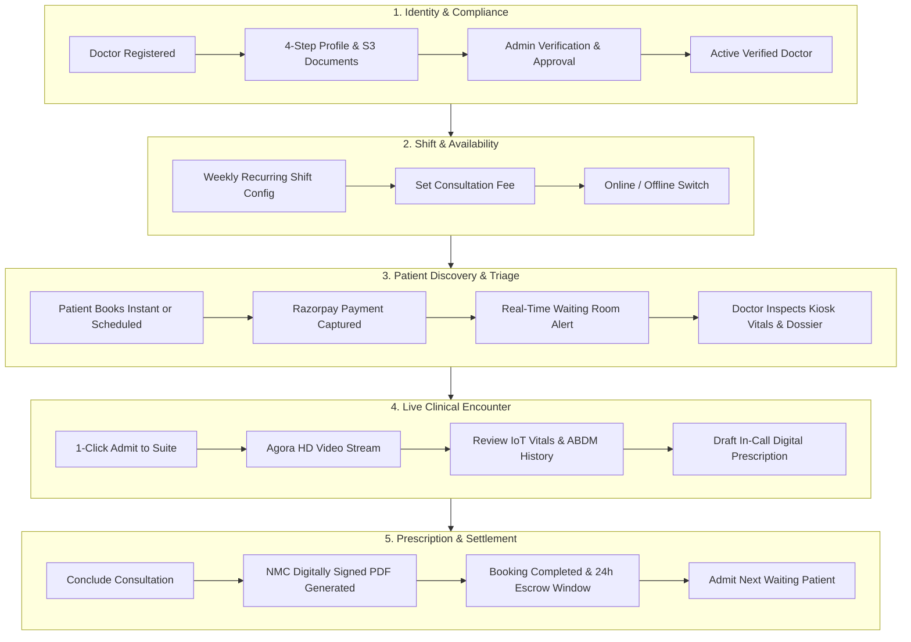

# ONYX HEALTH+ DOCTOR SYSTEM
## COMPLETE UI/UX PRODUCT & CLINICAL WORKFLOW SPECIFICATION

> **Document Type:** Product Architecture & UI/UX Design Handover Specification  
> **Target Audience:** Lead UI/UX Designers, Product Managers, Frontend Engineers  
> **System Scope:** Onyx Health+ Telehealth Doctor Module (Web Portal & Virtual Clinic)  
> **Compliance Standard:** National Medical Commission (NMC) Telemedicine Practice Guidelines & ABDM (Ayushman Bharat Digital Mission) EHR Consent Architecture  

---

## 1. Executive Summary & Product Vision

### 1.1 The Mission
The **Onyx Health+ Doctor System** is an ultra-premium, high-efficiency clinical workstation created for medical specialists conducting both **Instant Walk-in Consultations** (from mobile app and physical IoT Health Kiosks) and **Scheduled Video Appointments**.

Unlike conventional clunky EHR software, Onyx Health+ is designed with the simplicity, fluid elegance, and precision of modern digital products (inspired by Apple Health, Linear, and modern clinical workstations).

### 1.2 Core Design Tenets for the UI Designer
1. **Clinical Focus (Zero Clutter):** Doctors make critical decisions under time constraints. Every screen must eliminate visual noise, prioritizing vital clinical data, patient video, and quick prescription drafting.
2. **Harmonized Split-Screen Encounters:** Never hide patient data behind popup modals while on video. The live video stream and the patient's medical dossier/prescription pad must exist side-by-side.
3. **Real-Time IoT Telemetry First:** Kiosk-captured diagnostic vitals (Blood Pressure, Heart Rate, SpO2, Temperature, Blood Glucose) must be instantly recognizable through color-coded clinical health bands.
4. **Natural Clinical Workflow:** Seamless progression through: **Queue Triage $\rightarrow$ Active Video Consultation + SOAP Charting $\rightarrow$ 1-Click Signed Prescription $\rightarrow$ Next Patient Handover**.

---

## 2. Complete End-to-End System Workflows



---

### Workflow 1: Doctor Onboarding & Verification
1. **Account Creation:** Executive Admin invites doctor or doctor registers via OTP.
2. **4-Step Credential & Document Upload Wizard:**
   - **Step 1 — Personal & Bio:** Gender, DOB, Qualification (MBBS, MD, DM), Experience, Spoken Languages, Bio.
   - **Step 2 — Council Credentials:** Medical Council Registration Number, State Council, Specialization. Upload: Degree Certificate, Council Registration Card, Identity Proof (Govt ID).
   - **Step 3 — Legal & Telemedicine Compliance:** Mandatory checkboxes for NMC Telemedicine Practice Guidelines & Digital Prescription compliance.
   - **Step 4 — Clinic & Payout Account:** Clinic/Hospital affiliation, physical address, Bank Account details + Cancelled Cheque upload (for automated Razorpay Route partner payouts).
3. **Admin Audit:** Admin reviews S3 uploaded files $\rightarrow$ Approves or Rejects with specific feedback. Once approved, doctor profile goes live.

---

### Workflow 2: Daily Availability & Clinic Readiness
1. **Weekly Recurring Schedule:** Doctor sets daily shifts (e.g., Monday to Friday: 09:00–13:00, 16:00–20:00).
2. **Instant Consultation Toggle:** Doctor flips the **"Online — Accepting Calls"** switch on the header:
   - When **Online**: Kiosks and mobile patients see doctor as *Available Now for Instant Call*.
   - When **In-Clinic / Busy**: Instant calls are paused; only pre-scheduled bookings are received.
3. **Consultation Fee:** Doctor defines consultation fee (e.g., ₹500), automatically linked to payment gateway.

---

### Workflow 3: Patient Intake & Triage (The Virtual Waiting Room)
1. **Patient Booking:** Patient completes payment on Kiosk or mobile app.
2. **Real-Time Notification:**
   - Soft Web-Audio chime synthesizer plays on doctor’s portal.
   - High-priority **"Live Patient Waiting Now"** banner appears with patient name, booking type, and time.
3. **Queue Segmentation:** Doctor sees three dedicated tabs:
   - **Waiting Room (Live Queue):** Immediate walk-in patients waiting *right now*.
   - **Scheduled Today:** Upcoming appointments sorted chronologically with countdown.
   - **Completed:** Concluded consultations with historical records.
4. **Intake Dossier Preview:** Doctor clicks on any patient card to review:
   - Demographics (Name, Age, Gender, Phone).
   - Real-time IoT Kiosk Vitals (Blood Pressure, Pulse, Temp, SpO2).
   - Chief complaint and self-reported symptoms.
   - ABDM shared hospital records and lab diagnostic PDFs.

---

### Workflow 4: The Live Clinical Encounter (Full Consultation Suite)
*Transition is instant and occurs in-place — no popup modal dialogs covering patient records.*

1. Doctor clicks **"Admit to Consultation Suite"**.
2. Workstation transitions into a **harmonized split view**:
   - **Left Panel (58% width) — High-Definition Agora RTC Video Room:**
     - Patient’s live camera full-bleed with smooth 1080p rendering.
     - Top Call HUD: Live consultation timer badge (`08:24`), Patient name, Real-time BP pill (`BP: 124/82`), Agora encrypted badge.
     - Doctor’s Floating Self-View (PiP): Mirror-reflected camera with camera-off fallback.
     - Bottom Glassmorphic Control Dock: Mic mute/unmute, Camera toggle, Device settings, End Call button.
   - **Right Panel (42% width) — Live In-Call Clinical Chart & Prescription Pad:**
     - Doctor looks at patient on the left while simultaneously reviewing/charting on the right.
     - Live Kiosk Vitals HUD (BP, Heart Rate, Temp, SpO2).
     - Clinical Diagnosis input field.
     - **In-Call Digital Prescription Pad:** Type medicine name, dosage, frequency, duration, and instructions during the conversation.
3. Doctor clicks **"Conclude & Issue Rx"**.

---

### Workflow 5: Encounter Conclusion & Next Patient Transition
1. Call concludes gracefully: Agora streams close, booking status transitions to `"completed"` on backend.
2. **Digital Prescription Slip:**
   - Auto-generated official NMC-compliant digital prescription with doctor’s credentials, council registration number, clinic logo, QR code, and digital signature stamp.
   - 1-click **"Print / Download Official PDF"**.
3. **Automated Patient Handover:**
   - Screen identifies the next patient in the waiting room.
   - Prominent Primary Button: **"Admit Next Patient: [Name]"** $\rightarrow$ immediately opens next patient’s consultation room.
   - Secondary Button: **"Return to Waiting Room"**.

---

### Workflow 6: Payouts, Earnings & Dispute Escrow
1. **Razorpay Route Partner Model:** Patient fee (e.g. ₹500) captured into main merchant.
2. **Platform Commission:** Platform deducts fee (e.g. 15% = ₹75); doctor net earnings = ₹425.
3. **24-Hour Settlement Hold:**
   - If no dispute ticket raised by patient within 24 hours $\rightarrow$ funds automatically settled to doctor’s bank account.
   - If patient raises a dispute ticket $\rightarrow$ payout marked **"On Hold"** until Admin reviews and resolves.

---

## 3. Information Architecture & Sitemap

```
/dashboard/doctor
│
├── / (Executive Command Hub - Hero, Availability, Live Alerts, KPIs, Daily Agenda)
├── /consultations (Virtual Clinic - Waiting Room, Triage Queue, Active Consultation Suite)
├── /schedule (Weekly Working Hours, Break Multi-intervals, Slot Configurator)
├── /prescriptions (Digital Rx Registry, Search, Official PDF Print & Re-issue)
├── /reports (Kiosk IoT Diagnostic Telemetry & Lab Analytics)
├── /payments (Gross Earnings, Platform Commission Deductions, Razorpay Ledger)
├── /tickets (Support & Patient Dispute Inquiries with Escrow Status)
├── /profile (Doctor Credentials, Council Badges, Public Patient Profile Preview)
├── /notifications (System Notifications, Booking Alerts, Payout Confirmations)
├── /settings (Consultation Fee, Room Hardware Preferences, Notification Triggers)
└── /onboarding (4-Step NMC/ABDM Compliance Wizard & Document Uploads)
```

---

## 4. Screen-by-Screen UI/UX Specifications for the Designer

### Screen 1: Executive Command Hub (`/dashboard/doctor`)
*Purpose: The doctor's daily mission control. Provides instant status clarity, real-time waiting room alerts, and day agenda.*

#### Layout Grid
- **Header:** Doctor identity bar, specialty badge, verified practitioner pill, council reg number, and fee display.
- **Top Right Controls:**
  - Interactive Apple-style **Availability Switch** with live pulsing dot:
    - State A: *Online — Accepting Calls* (Emerald glow)
    - State B: *In-Clinic / On Break* (Warm amber glow)
  - Quick **"Device Check"** button (launches camera/mic hardware diagnostic test).
  - Primary CTA: **"Open Virtual Clinic"** (bold crimson pill button).
- **High-Priority Emergency Banner (Conditional):**
  - Appears with audio chime when patient is waiting or calling.
  - Pulsing crimson gradient border, live countdown timer, and **"JOIN VIDEO ROOM NOW"** button.
- **Metric Cards (4-Column Grid):**
  1. *Today's Appointments* (Calendar icon, primary blue)
  2. *Active in Queue* (Video icon, emerald active indicator)
  3. *Kiosk Vitals & Reports* (Activity icon, warm amber)
  4. *This Month Earnings* (CreditCard icon, emerald auto-settled badge)
- **Two-Column Agenda Dock:**
  - **Left (65%):** Today's appointment schedule feed with tabs (`All`, `Upcoming`, `In Progress`, `Completed`), patient avatars, times, and direct "Connect" buttons.
  - **Right (35%):** Next Patient in Line highlight card + Doctor Command Shortcuts + Recent Prescriptions list.

---

### Screen 2: Telehealth Virtual Clinic (`/dashboard/doctor/consultations`)
*Purpose: The core clinical engine. Operates in 3 fluid phases without disjointed popup modals.*

#### Phase 1 Layout: Waiting Room & Intake (Default)
- **Top Toolbar:** Page title, IoT Kiosk sync badge, Device check button, Refresh button, and **"Quick Register Walk-in"** modal launcher.
- **Left Column (35% width) — Patient Triage Queue:**
  - Search bar (by name, symptoms, phone number).
  - 3 segmented queue tabs with numeric badges:
    - `Waiting Room` (e.g. 3 waiting)
    - `Scheduled Today` (e.g. 5 upcoming)
    - `Completed` (e.g. 8 done)
  - Compact patient queue cards:
    - Patient avatar, Name, Age/Gender, Chief Complaint.
    - Slot time / wait time indicator.
    - Micro-vitals preview pill: `BP: 120/80` · `Pulse: 72 bpm`.
    - Active selection highlight (crimson border, soft rose tint, subtle ring).
- **Right Column (65% width) — Patient Dossier Panel:**
  - **Hero Bar:** Patient Avatar, Full Name, Age/Gender, Contact info, Booking reference, and a prominent **"Admit to Consultation Suite"** primary button.
  - **Kiosk IoT Diagnostic Telemetry:**
    - 4 prominent metric cards: Blood Pressure (mmHg), Pulse Rate (BPM), Body Temp (°F), SpO2 Saturation (%).
    - Color-coded bands: Normal (Emerald), Mild (Amber), Critical (Rose).
  - **Chief Complaint Card:** Detailed patient-reported symptoms and visit notes.
  - **ABDM Shared Records Card:** List of patient's diagnostic lab reports and PDFs with instant preview. If locked, includes NMC compliance declaration button.

---

#### Phase 2 Layout: Active Clinical Consultation Suite (In-Call)
*Triggered when doctor admits patient. Transitions seamlessly in-place.*

- **Top HUD Strip (Dark Slate):**
  - Back to Queue link.
  - Active Patient: Name, Age, Gender, Diagnosis.
  - Live Consultation Timer (`11:32` in font-mono emerald).
  - Real-time BP badge (`BP: 122/80`).
  - Primary Action Button: **"Conclude & Issue Rx"** (bold crimson gradient).
- **Main Workspace Split:**
  - **Left Stage (58% width) — High-Definition Video Room:**
    - Dark cinematic background (`#0A0F1D`).
    - Full-bleed Agora patient video stream (`#remote-video-container`).
    - Paused/Connecting fallback state: centered medical avatar + clean status label.
    - Floating Doctor PiP (top-right corner): rounded corners, shadow, mirror transform.
    - Bottom Floating Glass Dock:
      - Mic Toggle (White active / Rose muted).
      - Camera Toggle (White active / Rose off).
      - Leave / End Call button (Rose filled).
  - **Right Stage (42% width) — Live Clinical Chart & In-Call Prescription:**
    - **Vitals HUD:** Compact view of BP, Pulse, Temp, SpO2 always visible while looking at the patient.
    - **Live Clinical Diagnosis:** Input for provisional diagnosis.
    - **In-Call Prescription Pad:** Form fields for Medication Name, Dosage, Frequency (OD, BD, TDS, PRN), Duration, and Instructions.
    - **"Sign & Issue Prescription Slip"** button.

---

#### Phase 3 Layout: Post-Encounter Summary & Next Patient Handover
*Triggered when consultation is concluded.*

- **Centered Card Layout (Max-width 680px):**
  - Large success checkmark badge.
  - Title: *Encounter Completed for [Patient Name]*.
  - Prescription summary box showing prescribed medication, dosage, and frequency.
  - **1-Click Actions:**
    - **"Print Official PDF Slip"** (opens print dialog with signed NMC template).
    - **"Admit Next Patient: [Next Patient Name]"** (bold primary button jumping directly into Phase 2 for next in line).
    - **"Return to Waiting Room"** (returns to Phase 1 queue).

---

### Screen 3: Schedule & Shift Management (`/dashboard/doctor/schedule`)
*Purpose: Manage recurring weekly shifts, break intervals, and consultation slot durations.*

#### Key Elements
- **Weekly Shift Configurator (Monday through Sunday):**
  - Each day has an active toggle switch (On / Off).
  - Multi-interval working hours per day (e.g. Shift 1: 09:00–13:00, Shift 2: 17:00–20:00).
  - Slot duration selector: 15 mins, 20 mins, 30 mins, or 45 mins.
  - Buffer time between consultations: 5 mins, 10 mins.
- **Calendar Agenda Preview:** Live weekly and daily timeline view showing booked vs open slots.

---

### Screen 4: Digital Prescription Registry (`/dashboard/doctor/prescriptions`)
*Purpose: Historical registry of all electronic prescriptions issued by the doctor.*

#### Key Elements
- Search bar (by patient name, diagnosis, medication, date range).
- Table / Card view:
  - Date issued, Patient name, Diagnosis, Prescribed drugs, Status (Active / Concluded).
  - Action buttons: **"View Slip"**, **"Print PDF"**, **"Re-prescribe"**.
- Standardized NMC Digital Prescription template modal.

---

### Screen 5: Payouts, Earnings & Settlements (`/dashboard/doctor/payments`)
*Purpose: Transparent financial ledger showing gross earnings, platform commission deductions, and Razorpay Route transfers.*

#### Key Elements
- **Financial Metric Cards:**
  - Total Gross Earnings (₹).
  - Platform Commission Deducted (₹ / %).
  - Net Settled to Bank (₹).
  - Escrow On-Hold (₹, with dispute indicator if ticket exists).
- **Settlement Ledger Table:**
  - Date, Booking ID, Patient Name, Consultation Type, Gross Amount, Commission, Net Payout, Razorpay Transfer ID, Status (`Settled`, `Pending 24h Escrow`, `On Hold`).

---

### Screen 6: Support Tickets & Dispute Resolution (`/dashboard/doctor/tickets`)
*Purpose: Track patient complaints, network connectivity disputes, and escrow hold status.*

#### Key Elements
- Filter by status: `All`, `Under Review`, `Resolved`, `Refunded`.
- Ticket Details Card:
  - Patient name, Booking ID, Reason (e.g. "Call disconnected after 2 mins").
  - Escrow status badge: `Payout Held in Escrow`.
  - Admin resolution timeline and notes.

---

### Screen 7: Doctor Profile & Credentials (`/dashboard/doctor/profile`)
*Purpose: Manage doctor profile, degrees, council registration, and preview how patients see the doctor.*

#### Key Elements
- Verified Practitioner NMC Badge.
- Personal bio, qualifications, experience years, spoken languages.
- Council Registration Number & State Council.
- **"Live Patient View Preview":** An interactive mockup showing the exact doctor card patients see on the mobile app and kiosk discovery screens.

---

## 5. Design System & Visual Guidelines for the UI Designer

### 5.1 Color Palette

| Token Name | Hex Code | HSL Value | Semantic Role |
| :--- | :--- | :--- | :--- |
| **Onyx Crimson** | `#F2052C` | `350 96% 48%` | Primary brand accent, urgent calls, vital CTAs |
| **Crimson Light** | `#FF4B66` | `350 96% 65%` | Button gradients, hover highlights |
| **Onyx Slate** | `#14213D` | `221 51% 16%` | Hero banners, headers, dark stage contrast |
| **Medical Cyan** | `#35B7C9` | `187 58% 50%` | Secondary accent, technology, teleconsultation |
| **Vital Emerald** | `#10B981` | `158 64% 52%` | Normal vitals, online availability, success |
| **Caution Amber** | `#F59E0B` | `43 96% 56%` | Elevated vitals, pending approval, review |
| **Critical Rose** | `#E11D48` | `348 83% 47%` | Critical vitals, disconnect, emergency |
| **Soft Medical Canvas**| `#F8FAFC` | `210 40% 98%` | Primary application background |
| **Card Surface** | `#FFFFFF` | `0 0% 100%` | Cards, dossiers, elevated surfaces |

---

### 5.2 Typography System
- **Primary Typeface:** *Inter* or *Outfit* (Google Fonts) — modern, clean, high readability for medical records.
- **Monospace Typeface:** *JetBrains Mono* or *SF Mono* — used for all numeric telemetry: Blood Pressure (`120/80`), Pulse (`72 bpm`), Call Timers (`12:45`), Booking IDs.
- **Hierarchy:**
  - Page Title: `20px` to `24px` · Extrabold (`font-black`) · Tracking tight (`-0.02em`)
  - Section Headers: `16px` · Extrabold (`font-extrabold`)
  - Body Text: `13px` · Medium (`font-medium`) · Leading relaxed
  - Micro Badges & Pills: `10px` to `11px` · Bold (`font-bold`) · Uppercase tracking wider

---

### 5.3 UI Components & Spatial Aesthetics
- **Rounded Corners:** Modern pill & super-ellipse aesthetic (`rounded-[16px]` to `rounded-[24px]`).
- **Elevation & Shadows:** Soft, multi-layered ambient shadows:  
  `box-shadow: 0 4px 20px -4px rgba(0, 0, 0, 0.04), 0 2px 6px -2px rgba(0, 0, 0, 0.02);`
- **Borders:** Subtle hairline borders (`border border-slate-200/80` in light mode, `border-slate-800` in dark stage).
- **Interactive Micro-Animations:**
  - Live online availability indicator with gentle green pulse.
  - Smooth card selection transition with crimson accent ring.
  - Seamless layout transition from Queue to In-Call Consultation Suite.

---

## 6. Designer Checklist & Deliverables Expected

When creating Figma or Sketch files based on this specification, please deliver:

1. [ ] **Executive Command Hub:** Desktop (`1440px`) & Tablet (`1024px`) responsive views.
2. [ ] **Availability States:** Online mode vs. Offline/Break mode toggle visual states.
3. [ ] **Virtual Clinic — Phase 1 (Waiting Room):** 3-tab queue, patient card states (default, hover, selected), and right-hand patient dossier.
4. [ ] **Virtual Clinic — Phase 2 (Live Consultation Suite):** Full-screen split layout showing Agora video room on left and in-call clinical chart/prescription pad on right.
5. [ ] **Virtual Clinic — Phase 3 (Post-Encounter Transition):** Concluded consultation card with print PDF slip and "Admit Next Patient" CTA.
6. [ ] **Incoming Ringing Call Alert:** High-priority floating banner with countdown timer.
7. [ ] **Schedule Configurator:** Weekly recurring shifts and slot duration modal.
8. [ ] **Prescription Registry & PDF Template:** Official NMC prescription slip preview.
9. [ ] **Component Library:** Color tokens, typography styles, pill badges, buttons, vitals chips, and input fields.
