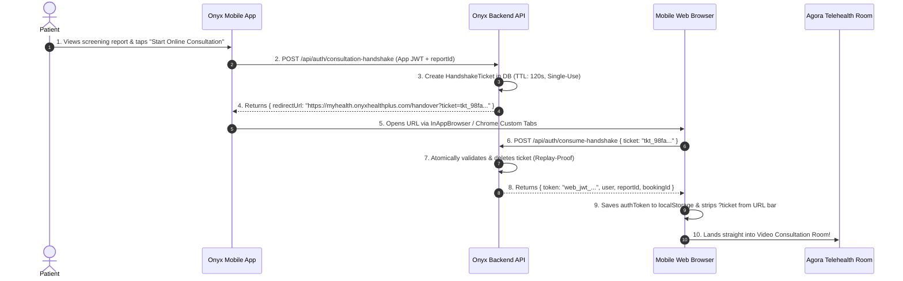

# MOBILE APP TO WEB SEAMLESS CONSULTATION HANDOVER
## Single Sign-On (SSO) & Zero-Login Deep Link Specification

**Document Version:** 1.0  
**Target Teams:** Backend Engineering, Mobile App Team (Flutter/React Native), Patient WebApp Team  
**Scope:** Onyx Health+ Screening-to-Consultation Transition  

---

## 1. Problem Statement

In the current workflow:
1. A patient performs an offline/kiosk health screening on the **Onyx Mobile App**.
2. Screening results (BP, SpO2, Pulse, BMI, ECG) are generated.
3. The patient taps **"Online Consultation"** in the app.
4. The mobile app launches the web browser (`https://myhealth.onyxhealthplus.com/...`).
5. **The Problem:** The mobile browser does not have the patient's authenticated JWT session. As a result:
   - The patient is redirected to the **Login Screen**.
   - The patient must re-enter their credentials/OTP.
   - After login, the patient is on a generic dashboard and has to manually find a doctor and re-attach their screening results.
   - This friction causes substantial patient drop-off and frustration.

### Desired Solution
The patient taps **"Online Consultation"** in the mobile app and is **instantly launched directly into the video consultation room (or pre-filtered booking screen)** with **ZERO login prompts**, with their screening vitals automatically loaded onto the doctor's consultation screen.

---

## 2. Architecture: Single-Use Handshake Ticket System

To bridge the authentication context between the mobile app (which has the user's JWT) and the mobile browser (which starts with an empty `localStorage`), we use a **Single-Use, Time-Limited Handshake Ticket**.



---

## 3. Database Schema (MongoDB / Mongoose)

Create a dedicated collection `handshakeTickets` in `src/models/handshakeTicket.js`:

```javascript
const mongoose = require('mongoose');

const handshakeTicketSchema = new mongoose.Schema({
  // Cryptographically random single-use ticket
  ticket: { 
    type: String, 
    required: true, 
    unique: true, 
    index: true 
  },
  
  userId: { 
    type: mongoose.Schema.Types.ObjectId, 
    ref: 'User', 
    required: true 
  },
  
  profileId: { 
    type: mongoose.Schema.Types.ObjectId, 
    ref: 'Profile', 
    default: null 
  },
  
  reportId: { 
    type: mongoose.Schema.Types.ObjectId, 
    ref: 'Report', 
    default: null 
  },
  
  doctorId: { 
    type: mongoose.Schema.Types.ObjectId, 
    ref: 'DoctorDetails', 
    default: null 
  },
  
  bookingId: { 
    type: mongoose.Schema.Types.ObjectId, 
    ref: 'Booking', 
    default: null 
  },
  
  // Destination target on web app
  targetRoute: { 
    type: String, 
    default: '/consultation/room' 
  },
  
  // Automatic MongoDB TTL Expiry (Records auto-delete after 2 minutes)
  expiresAt: { 
    type: Date, 
    required: true, 
    index: { expires: 0 } 
  }
}, { timestamps: true });

module.exports = mongoose.model('HandshakeTicket', handshakeTicketSchema);
```

---

## 4. Backend Endpoints Implementation

### 4.1 Ticket Generation Endpoint
Called by the **Mobile App** before launching the browser.

- **Route:** `POST /api/auth/consultation-handshake`
- **Auth:** JWT (`ensureAuth`, role: `user` / `patient`)
- **Controller Implementation:**

```javascript
const crypto = require('crypto');
const HandshakeTicket = require('../models/handshakeTicket');

const createConsultationHandshake = async (req, res) => {
  try {
    const { reportId, profileId, doctorId, bookingId, targetRoute } = req.body;
    const userId = req.user.id;

    // 1. Generate secure random ticket string
    const ticket = 'tkt_' + crypto.randomBytes(32).toString('hex');

    // 2. Set TTL to 2 minutes (120 seconds)
    const expiresAt = new Date(Date.now() + 2 * 60 * 1000);

    // 3. Save ticket
    await HandshakeTicket.create({
      ticket,
      userId,
      profileId: profileId || null,
      reportId: reportId || null,
      doctorId: doctorId || null,
      bookingId: bookingId || null,
      targetRoute: targetRoute || (bookingId ? `/consultation/room/${bookingId}` : '/consultation/select-doctor'),
      expiresAt
    });

    // 4. Construct deep-link redirect URL
    const patientWebBaseUrl = process.env.PATIENT_WEB_URL || 'https://myhealth.onyxhealthplus.com';
    const redirectUrl = `${patientWebBaseUrl}/handover?ticket=${ticket}`;

    return res.status(200).json({
      status: 'success',
      ticket,
      redirectUrl,
      expiresInSeconds: 120
    });
  } catch (err) {
    console.error('Handshake ticket creation error:', err);
    return res.status(500).json({ status: 'fail', error: 'Could not generate consultation handshake ticket.' });
  }
};
```

---

### 4.2 Ticket Consumption & Session Exchange Endpoint
Called by the **Web App** as soon as it opens in the browser.

- **Route:** `POST /api/auth/consume-handshake`
- **Auth:** Public (Ticket acts as single-use temporary bearer credential)
- **Controller Implementation:**

```javascript
const jwt = require('jsonwebtoken');
const HandshakeTicket = require('../models/handshakeTicket');
const User = require('../models/user');

const consumeConsultationHandshake = async (req, res) => {
  try {
    const { ticket } = req.body;

    if (!ticket || typeof ticket !== 'string') {
      return res.status(400).json({ status: 'fail', error: 'Handshake ticket is required.' });
    }

    // 1. Atomically find and DELETE ticket (Ensures it can only be used once!)
    const ticketDoc = await HandshakeTicket.findOneAndDelete({
      ticket,
      expiresAt: { $gt: new Date() }
    });

    if (!ticketDoc) {
      return res.status(401).json({
        status: 'fail',
        error: 'Consultation handover ticket is invalid or has expired. Please try again from your mobile app.'
      });
    }

    // 2. Fetch authenticated patient
    const user = await User.findById(ticketDoc.userId).select('-password');
    if (!user) {
      return res.status(404).json({ status: 'fail', error: 'Patient account not found.' });
    }

    // 3. Sign standard web JWT session token (e.g., 7 days validity)
    const webToken = jwt.sign(
      {
        id: user._id,
        role: user.role || 'user',
        name: user.name,
        phone: user.phone_number
      },
      process.env.JWT_SECRET,
      { expiresIn: '7d' }
    );

    // 4. Return authenticated session payload with target routing parameters
    return res.status(200).json({
      status: 'success',
      token: webToken,
      user: {
        id: user._id,
        name: user.name,
        phone: user.phone_number,
        role: user.role
      },
      payload: {
        reportId: ticketDoc.reportId,
        profileId: ticketDoc.profileId,
        doctorId: ticketDoc.doctorId,
        bookingId: ticketDoc.bookingId,
        targetRoute: ticketDoc.targetRoute
      }
    });
  } catch (err) {
    console.error('Handshake consumption error:', err);
    return res.status(500).json({ status: 'fail', error: 'Internal error processing consultation handshake.' });
  }
};
```

---

## 5. Mobile App Implementation Guide (Flutter & React Native)

### 5.1 Flutter Implementation Example
In your screening result screen (`screening_results_screen.dart`):

```dart
import 'dart:convert';
import 'package:http/http.dart' as http;
import 'package:url_launcher/url_launcher.dart';

Future<void> launchSeamlessConsultation({
  required String userJwtToken,
  required String reportId,
  String? doctorId,
  String? bookingId,
}) async {
  final url = Uri.parse("https://dev-api.onyxhealthplus.com/api/auth/consultation-handshake");

  final response = await http.post(
    url,
    headers: {
      "Content-Type": "application/json",
      "Authorization": "Bearer $userJwtToken",
    },
    body: jsonEncode({
      "reportId": reportId,
      "doctorId": doctorId,
      "bookingId": bookingId,
    }),
  );

  if (response.statusCode == 200) {
    final data = jsonDecode(response.body);
    final String redirectUrl = data["redirectUrl"];

    // Launch in Chrome Custom Tabs / Safari In-App Browser for seamless WebRTC camera access
    await launchUrl(
      Uri.parse(redirectUrl),
      mode: LaunchMode.inAppBrowserView, // Keeps the patient in the app context
    );
  } else {
    print("Handshake failed: ${response.body}");
  }
}
```

---

## 6. Patient Web App Implementation Guide (`onyx-patient-flow`)

### 6.1 Route Registration (`App.tsx`)
Register the handover route in your React router:

```tsx
<Route path="/handover" element={<HandoverLanding />} />
```

### 6.2 Handover Component (`src/pages/HandoverLanding.tsx`)

```tsx
import { useEffect, useState } from "react";
import { useNavigate, useSearchParams } from "react-router-dom";
import { Loader2, Stethoscope, AlertCircle } from "lucide-react";
import { Button } from "@/components/ui/button";

export default function HandoverLanding() {
  const [searchParams] = useSearchParams();
  const navigate = useNavigate();
  const [error, setError] = useState<string | null>(null);

  const ticket = searchParams.get("ticket");

  useEffect(() => {
    async function executeHandover() {
      if (!ticket) {
        setError("Invalid session ticket. Please initiate consultation from your mobile app.");
        return;
      }

      try {
        const response = await fetch(`${import.meta.env.VITE_BACKEND_URL}/api/auth/consume-handshake`, {
          method: "POST",
          headers: { "Content-Type": "application/json" },
          body: JSON.stringify({ ticket }),
        });

        const data = await response.json();

        if (response.ok && data.status === "success") {
          // 1. Establish user session in web localStorage
          localStorage.setItem("authToken", data.token);
          localStorage.setItem("userId", data.user.id);
          localStorage.setItem("userName", data.user.name);

          // 2. Remove sensitive ticket parameter from browser history
          window.history.replaceState({}, document.title, window.location.pathname);

          // 3. Seamlessly redirect directly to the consultation room or doctor selector
          const { bookingId, reportId, doctorId, targetRoute } = data.payload || {};

          if (bookingId) {
            navigate(`/consultation/room/${bookingId}`);
          } else if (targetRoute) {
            navigate(targetRoute);
          } else {
            navigate(`/consultation/select-doctor?reportId=${reportId || ""}&doctorId=${doctorId || ""}`);
          }
        } else {
          setError(data.error || "The consultation session has expired. Please retry from the mobile app.");
        }
      } catch (err) {
        setError("Network error connecting to telehealth servers. Please check your connection.");
      }
    }

    executeHandover();
  }, [ticket, navigate]);

  if (error) {
    return (
      <div className="h-screen w-screen flex flex-col items-center justify-center bg-slate-900 text-white p-6 text-center">
        <div className="h-16 w-16 rounded-full bg-rose-500/10 text-rose-500 flex items-center justify-center mb-4 border border-rose-500/20">
          <AlertCircle className="h-8 w-8" />
        </div>
        <h2 className="text-xl font-bold">Session Link Expired</h2>
        <p className="text-slate-400 text-sm max-w-sm mt-2">{error}</p>
        <Button 
          onClick={() => navigate("/login")}
          className="mt-6 bg-[#F2052C] hover:bg-rose-700 font-bold px-6 rounded-xl"
        >
          Go to Standard Login
        </Button>
      </div>
    );
  }

  return (
    <div className="h-screen w-screen flex flex-col items-center justify-center bg-slate-950 text-white gap-4">
      <div className="h-14 w-14 rounded-2xl bg-gradient-to-tr from-[#F2052C] to-[#FF4B66] flex items-center justify-center shadow-lg shadow-rose-600/30">
        <Stethoscope className="h-7 w-7 text-white" />
      </div>
      <div className="flex items-center gap-2">
        <Loader2 className="h-5 w-5 animate-spin text-[#35B7C9]" />
        <span className="text-sm font-bold tracking-wide">Connecting your Telehealth Session...</span>
      </div>
      <p className="text-xs text-slate-500">Retrieving diagnostic screening vitals from your kiosk session</p>
    </div>
  );
}
```

---

## 7. Connecting Screening Vitals to the Doctor's Video Screen

Because the ticket records `reportId`:
1. When the patient lands in the video room, the booking/session retains `reportId`.
2. When the **Doctor** joins via `Consultations.tsx`, the frontend automatically fetches the report details:
   ```typescript
   const report = await viewReport(booking.reportId);
   ```
3. The doctor's **In-Call Notes & Telemetry Drawer** automatically populates with the patient's real kiosk readings:
   - **Blood Pressure:** e.g., `124/82 mmHg`
   - **Heart Rate / Pulse:** e.g., `74 bpm`
   - **Temperature:** e.g., `98.4°F`
   - **SpO2:** e.g., `99%`
4. The doctor can examine the patient on video while simultaneously reviewing their screening data on the side panel.

---

## 8. Security & Anti-Abuse Considerations

1. **Strict 2-Minute Expiry (TTL):** Handshake tickets expire 120 seconds after creation. If not consumed, they are automatically purged by MongoDB.
2. **Single-Use Atomicity:** `findOneAndDelete()` guarantees a ticket can never be reused or shared.
3. **URL Bar Scrubbing:** Calling `window.history.replaceState()` immediately removes the `?ticket=...` query from the address bar, preventing URL leakage via browser history or shoulder-surfing.
4. **Origin Validation:** The backend endpoint only issues redirects matching approved domain names (e.g., `*.onyxhealthplus.com`).

---

## 9. Verification & Testing Instructions

### Test Case 1: Successful Handover
```bash
# 1. Mobile App generates ticket
curl -X POST https://dev-api.onyxhealthplus.com/api/auth/consultation-handshake \
  -H "Authorization: Bearer <VALID_MOBILE_JWT>" \
  -H "Content-Type: application/json" \
  -d '{"reportId": "6ad874c7703f3d2233088660", "doctorId": "6a47d909f718c2c2cf25cc35"}'

# Response:
# { "status": "success", "ticket": "tkt_a1b2c3d4...", "redirectUrl": "https://myhealth.onyxhealthplus.com/handover?ticket=tkt_a1b2c3d4..." }

# 2. Web App consumes ticket
curl -X POST https://dev-api.onyxhealthplus.com/api/auth/consume-handshake \
  -H "Content-Type: application/json" \
  -d '{"ticket": "tkt_a1b2c3d4..."}'

# Response:
# { "status": "success", "token": "eyJhbGciOi...", "user": { "id": "...", "name": "Patient Name" } }
```

### Test Case 2: Replay Attack (Must Fail)
- Re-run Step 2 with the same ticket:
  - **Expected:** HTTP 401 Unauthorized (`"Handshake ticket is invalid or has expired"`).

### Test Case 3: Expired Ticket (Must Fail)
- Wait 2.5 minutes before running Step 2:
  - **Expected:** HTTP 401 Unauthorized.
